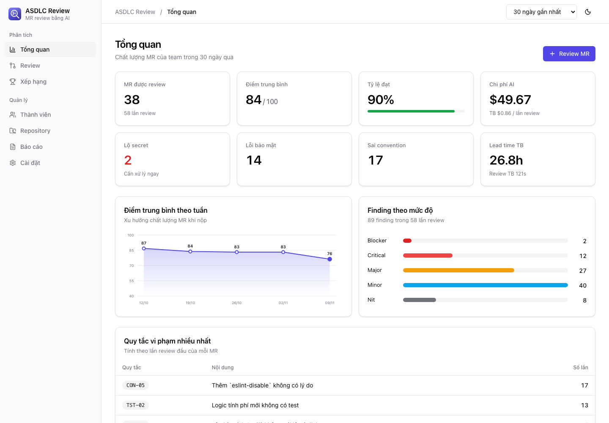
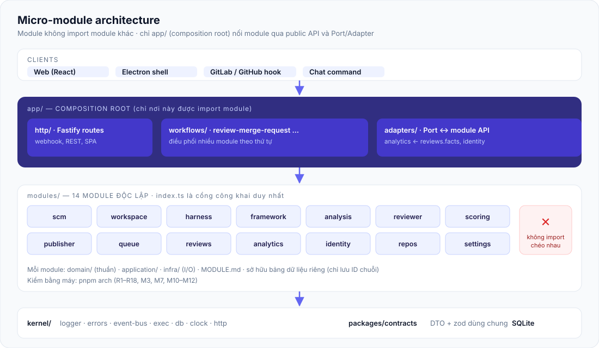
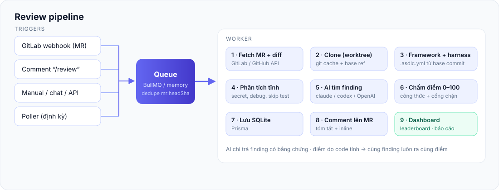
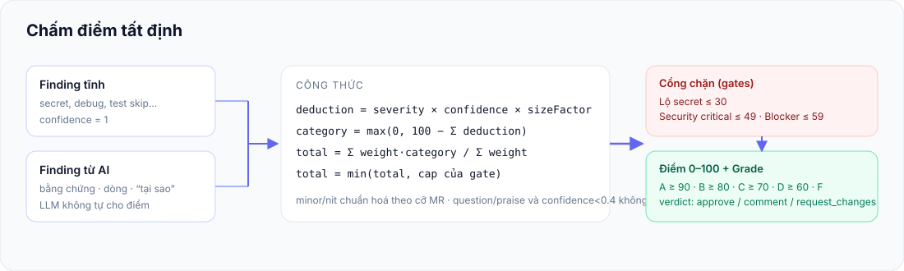
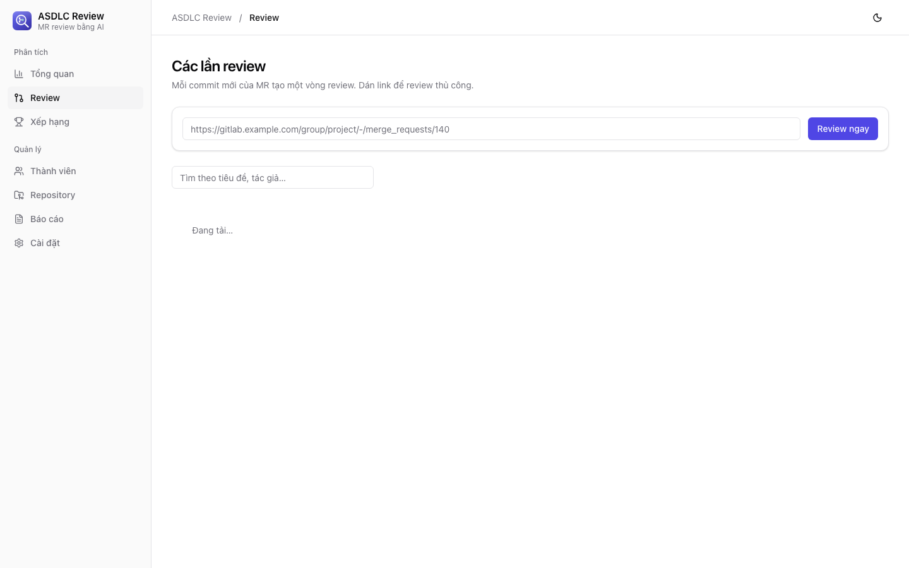
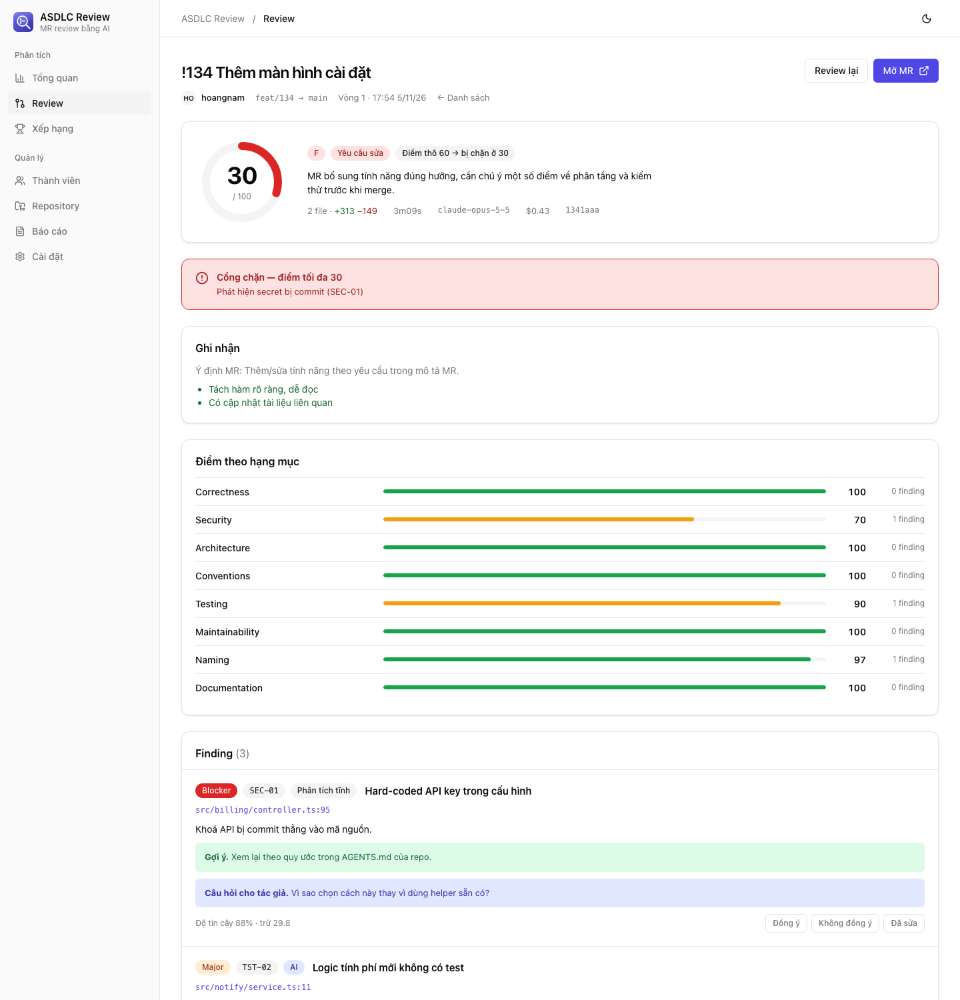
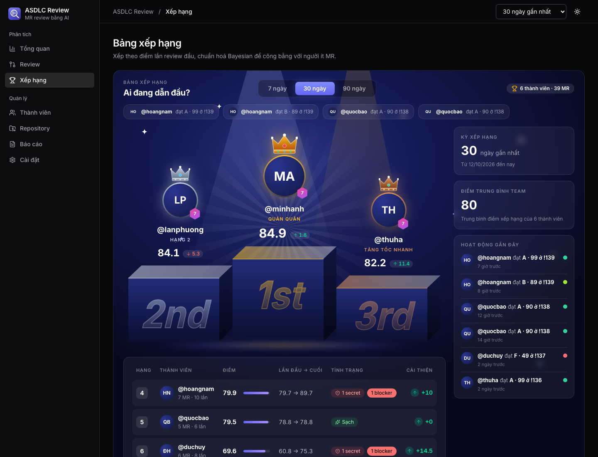
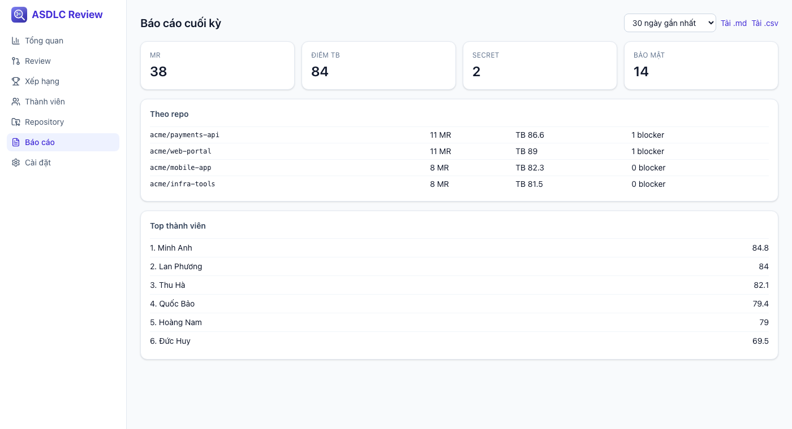

<p align="center">
  
</p>

<p align="center">
  <b>Review merge request bằng AI theo framework ASDLC + harness riêng của từng repo.<br/>Điểm 0–100 do code tính — minh bạch, lặp lại được.</b>
</p>

<p align="center">
  <a href="../../actions/workflows/ci.yml"></a>
  <a href="../../releases"></a>
  
  
</p>

<p align="center">
  <a href="https://nguyendinhphongdx.github.io/asdlc-review/">Landing page</a> ·
  <a href="../../releases">Releases</a> ·
  <a href="docs/MODULES.md">Kiến trúc</a> ·
  <a href="docs/SCORING.md">Chấm điểm</a>
</p>

<p align="center"></p>

## Mục lục
[Vì sao có dự án này](#vì-sao-có-dự-án-này) · [Tính năng](#tính-năng) · [Kiến trúc](#kiến-trúc) · [Chấm điểm](#chấm-điểm-tất-định) · [Ảnh chụp](#ảnh-chụp) · [Cài đặt](#cài-đặt) · [Cấu hình](#cấu-hình-env) · [Kết nối GitLab](#kết-nối-gitlab) · [Harness repo](#harness-riêng-của-repo) · [API](#api) · [Phát triển](#phát-triển) · [Release](#phát-hành-release) · [Bảo mật](#bảo-mật)

## Vì sao có dự án này
Khi nhiều dev dùng AI "vibecoding" trên nhiều repo, mỗi repo có harness riêng (README, `AGENTS.md`, `CLAUDE.md`, subagent, skill, tài liệu tính năng), người review không thể đọc hết từng MR. **ASDLC Review** tự clone repo, nạp framework chung và harness của repo đó, review theo bộ tiêu chí chi tiết (convention, kiến trúc, đặt tên, “vì sao làm vậy?”), chấm điểm, comment lại cho tác giả để họ cải thiện, và gom số liệu cho leaderboard và báo cáo cuối kỳ.

## Tính năng
- **Nhiều cách trigger:** webhook GitLab, comment `/review` hoặc `@mr-reviewer review`, dán link trên giao diện, API chat, poller định kỳ.
- **Hiểu harness của repo:** đọc README, AGENTS.md, CLAUDE.md, skill, subagent và tài liệu tính năng trong giới hạn ngân sách ngữ cảnh.
- **Phân tích tĩnh + AI:** secret, debug code, test bị skip, suppress lint, TODO… chạy tất định; AI tìm vấn đề còn lại, kèm bằng chứng và câu hỏi “tại sao”.
- **Điểm tất định:** LLM không tự cho điểm; công thức + cổng chặn tính điểm 0–100.
- **AI đa nhà cung cấp:** `claude` CLI, `codex` CLI hoặc API tương thích OpenAI.
- **Dashboard:** tổng quan, danh sách review, chi tiết finding (có phản hồi đồng ý/không), leaderboard Bayesian, thành viên, repo, báo cáo `.md`/`.csv`.
- **Desktop:** vỏ Electron tuỳ chọn; server cũng chạy headless được.

## Kiến trúc
Backend là **micro-module**: 14 module độc lập, không import lẫn nhau, mỗi module sở hữu logic và dữ liệu riêng, chỉ lộ `index.ts`. Chỉ `app/` (composition root) nối chúng qua public API và Port/Adapter. Luật được kiểm bằng máy (`pnpm arch`).



### Luồng review


### Cấu trúc thư mục
```
apps/
  server/            Fastify API + webhook + worker
    src/kernel/        config, logger, errors, event-bus, exec, db, clock, http
    src/modules/<m>/   14 module: domain/ application/ infra/ + index.ts + MODULE.md
    src/app/           composition root: http/, workflows/, adapters/
    prisma/schema/     mỗi module một file .prisma (không quan hệ chéo)
  web/               React 19 + Vite + Tailwind v4 + shadcn/ui, design token, dark mode (features/<x>/ độc lập)
  desktop/           vỏ Electron mỏng
packages/contracts/  DTO + zod dùng chung
frameworks/asdlc/    framework chung: ~50 tiêu chí, mức độ, cổng chặn
docs/  tools/arch/   tài liệu, bộ kiểm luật kiến trúc
```

## Chấm điểm tất định


`deduction = severity × confidence × sizeFactor`; hạng mục lấy trung bình có trọng số; cổng chặn: lộ secret ≤ 30, lỗi bảo mật critical ≤ 49, có blocker ≤ 59. Chi tiết và công thức leaderboard: [docs/SCORING.md](docs/SCORING.md).

## Ảnh chụp
| Danh sách review | Chi tiết finding |
|---|---|
|  |  |
| **Leaderboard thi đua** (podium top 3, animation, confetti) | **Báo cáo cuối kỳ** |
|  |  |

*Giao diện dùng shadcn/ui + Tailwind với token màu (sáng/tối); ảnh chụp tĩnh, trên app thật podium có animation.*

*Ảnh chụp dùng dữ liệu demo giả (`apps/server/scripts/seed-demo.ts`).*

## Cài đặt
### Yêu cầu
| | |
|---|---|
| Node.js | 22+ |
| pnpm | 10+ |
| git | có trong `PATH` |
| AI | `claude` hoặc `codex` CLI đã đăng nhập, **hoặc** `OPENAI_API_KEY` |
| Redis | tuỳ chọn; đặt `REDIS_URL=memory` để dùng hàng đợi trong process |

### Chạy từ mã nguồn
```bash
git clone https://github.com/nguyendinhphongdx/asdlc-review.git
cd asdlc-review
cp .env.example .env     # tuỳ chọn: token GitLab nhập được trên UI
pnpm install
pnpm redis               # tuỳ chọn: docker compose up -d redis
pnpm db:push             # tạo SQLite (cũng tự chạy lần đầu)
pnpm build               # build web
pnpm dev                 # server :4319 + web :5173
```
Production: `pnpm build` rồi `pnpm --filter @mrd/server start` (server phục vụ luôn web). Hoặc tải gói ở [Releases](../../releases), giải nén và chạy các bước trên.

### Chạy desktop
```bash
pnpm desktop
```

## Cấu hình (`.env`)
| Biến | Ý nghĩa |
|---|---|
| `GITLAB_URL`, `GITLAB_TOKEN`, `GITLAB_WEBHOOK_SECRET` | Dự phòng; thường nhập trên UI (ưu tiên giá trị lưu trong DB). Webhook không có secret thì bị từ chối |
| `MRD_SECRET_KEY` | Khoá mã hoá token trong DB (≥ 16 ký tự). Bỏ trống: tự tạo `data/secret.key` |
| `GITHUB_TOKEN`, `GITHUB_WEBHOOK_SECRET` | Cho GitHub (đang phát triển) |
| `BOT_MENTION` | Từ khoá trong comment để trigger review |
| `REVIEW_PROVIDER` | `claude-cli` \| `codex-cli` \| `openai-compatible` |
| `CLAUDE_MODEL`, `CLAUDE_MAX_BUDGET_USD` | Model và trần chi phí mỗi review |
| `OPENAI_BASE_URL`, `OPENAI_API_KEY`, `OPENAI_MODEL` | Provider tương thích OpenAI |
| `REDIS_URL` | `redis://…` hoặc `memory` |
| `DATA_DIR`, `DATABASE_URL` | Nơi lưu repo cache và SQLite |
| `INLINE_MIN_SEVERITY`, `MAX_INLINE_COMMENTS` | Điều khiển comment inline |
| `POLL_INTERVAL_MIN` | >0 bật poller (khi không nhận được webhook) |

## Kết nối GitLab
Làm theo [docs/SETUP.md](docs/SETUP.md): nhập URL + token ở **Cài đặt → Kết nối** (token được mã hoá trong DB), bấm **Kiểm tra kết nối**, thêm repo ở **Repository** (có nút tạo webhook tự động), rồi dán link MR hoặc comment `/review`.

## Harness riêng của repo
Repo có thể thêm `.asdlc.yml` (chọn framework, ghi đè trọng số, bỏ qua đường dẫn…). File được đọc từ **commit gốc của nhánh đích**, không phải nhánh MR, để tác giả không tự nới tiêu chí; sửa nó trong MR sẽ bị gắn cờ. Provider AI không chọn được qua file này.

## API
| Method | Đường dẫn | Mô tả |
|---|---|---|
| POST | `/webhooks/gitlab` | Webhook MR + comment |
| POST | `/api/reviews` | `{ url }` review thủ công |
| POST | `/api/chat/command` | `review <url>`, `status <url>`, `leaderboard 7d` |
| GET | `/api/reviews`, `/api/reviews/:id` | Danh sách và chi tiết |
| GET | `/api/overview`, `/api/leaderboard`, `/api/reports` | Thống kê (`?days=30`) |
| GET | `/api/reports/export.md`, `/export.csv` | Xuất báo cáo |
| GET/PUT | `/api/settings`, `/api/members`, `/api/repos` | Quản trị |
| GET | `/api/health`, `/api/providers`, `/api/queue` | Trạng thái |

## Phát triển
```bash
pnpm verify     # arch + typecheck + test
```
Quy tắc kiến trúc: [docs/MODULES.md](docs/MODULES.md) · tổng quan: [docs/ARCHITECTURE.md](docs/ARCHITECTURE.md) · hướng dẫn cho agent: [AGENTS.md](AGENTS.md).
Dữ liệu demo: `pnpm --filter @mrd/server exec node --import tsx scripts/seed-demo.ts` (đặt `DATA_DIR` riêng).

## Phát hành (release)
```bash
git tag v0.3.1 && git push origin v0.3.0
```
Workflow `release.yml` chạy verify, build web, đóng gói `asdlc-review-<tag>.tar.gz` (+ sha256), tạo GitHub Release, rồi build app desktop trên 3 runner (macOS Apple Silicon, macOS Intel, Windows) và đính kèm `ASDLC-Review-{mac-arm64,mac-x64,win-x64}.zip`. Build thử cục bộ: `pnpm pack:desktop`. App chưa ký số: macOS bấm chuột phải → Mở; Windows SmartScreen → Run anyway. Trang tải xuống trên landing page tự đề xuất bản theo hệ điều hành người xem.

| Workflow | Khi nào | Làm gì |
|---|---|---|
| `ci.yml` | push `main`, PR | arch, typecheck, test, build |
| `pages.yml` | đổi `site/**` | deploy landing page lên GitHub Pages |
| `release.yml` | push tag `v*` | tạo GitHub Release kèm gói |

## Bảo mật
Diff và mô tả MR là dữ liệu không tin cậy; secret phát hiện được bị che, không lưu; token git chỉ truyền qua header từng lệnh; worktree bị gỡ `.claude/settings*.json`, `.mcp.json`, `.codex/config.toml` trước khi AI đọc.

## Trạng thái
MVP: backend, dashboard và luồng review đã có test end-to-end với git/SQLite thật và AI/GitLab giả. Chưa kiểm chứng trên môi trường thật: gọi `claude`/`codex` thực tế, webhook GitLab thật, Redis/BullMQ thật, GitHub.

## Giấy phép
[MIT](LICENSE)
